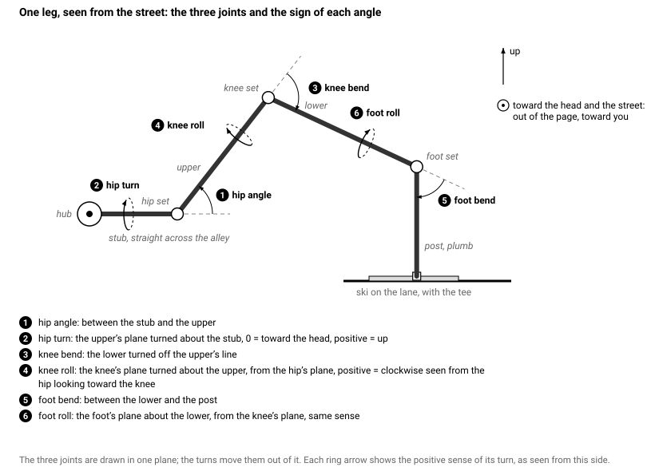
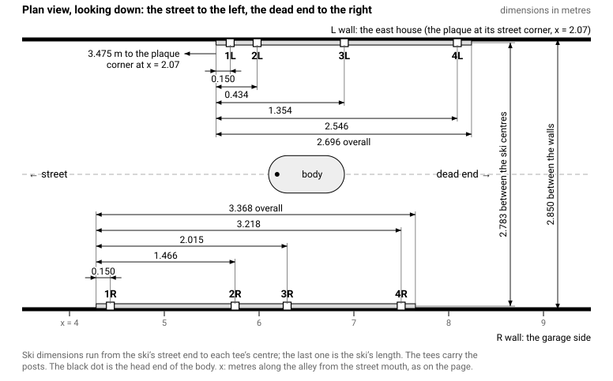
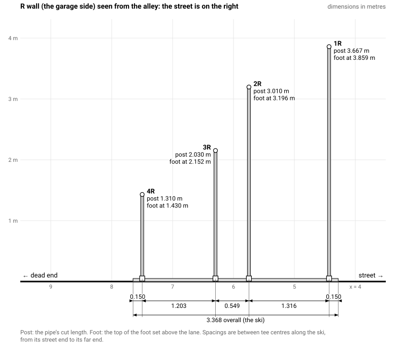
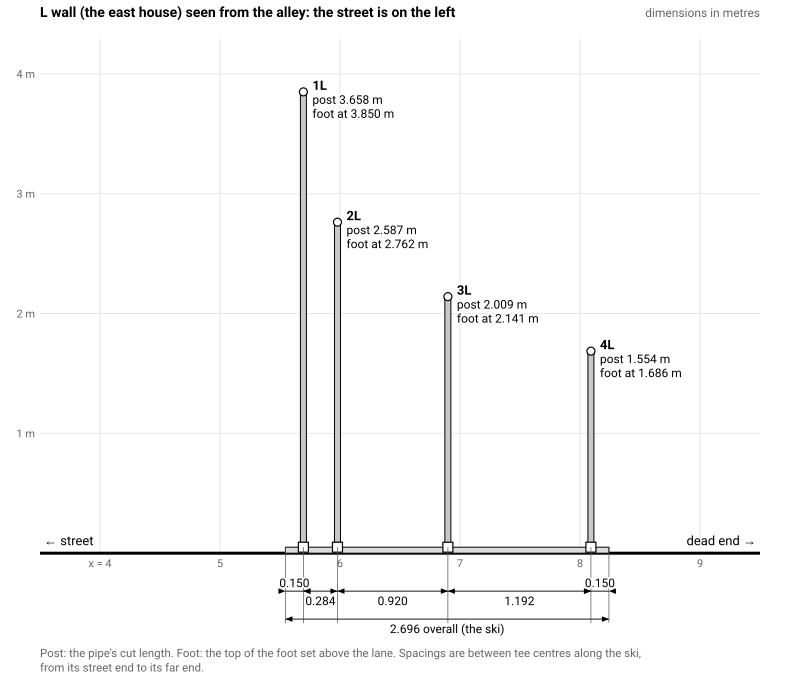

# Alley Spider Build Sheet

The dimensions and angles of the eight legs as they will be built from the tubes already cut, and the support structure for them, for the alley as measured on 2026-10-26: 2.85 m between the walls. Written 2026-10-26 from the visualizer's "default" design in its as-built part system (aluminium Ø 40 legs in Ø 40 PVC fittings, a PVC hub, PVC Ø 50 posts and skis). It supersedes the leg angles, the positions and the structure numbers of the assembly manual of 2026-10-15; the manual's methods (marking, cementing, packing, the lift) still apply and are referred to below.

## What this sheet assumes

- The sixteen leg tubes are cut to the manual's lengths (the table in The legs). A tube more than 3 mm off its length changes the angles at its two ends by a fraction of a degree, which the fixes on the island absorb; a tube off by a centimetre or more: tell me the length and I will solve again.
- The hub is built: four crosses touching end to end, 0.116 m centre to centre, with 0.078 m stubs, except the two L stubs of X2 and X3, which are longer because their hip set is a single 30° elbow. The hip elbows are not yet on.
- Every socket in the Ø 40 PVC fittings takes the tube 21 mm deep (your measurement), in a fitting of the catalogue's outside size. So every pipe stops 6 mm short of where the catalogue's 27 mm socket would put it, and every length below is computed that way. Check it once more before anything is cemented (Check first).
- The walls are 2.85 m apart where the posts stand, and the body hangs on the alley's centreline, 1.425 m from each wall; its centre is 6.5 m along the alley from the junction of the road centrelines, 2.603 m up, pitched 45° head toward the street.
- The elbow sets are the ones bought for v1, with one change: the knee of leg 2L becomes a pair of 45° elbows with a coupler (from the spares) instead of the single 67.5°, because with three single elbows that leg could only land its foot on top of 1L's post. Every other single elbow is kept and now makes its joint's angle exactly; every pair is set to the twist in the tables.
- Names are the manual's: legs 1R to 4L, front pair first, R the right-hand wall looking in from the street (the garage side), L the east house with the plaque. 1R-U is the upper tube of 1R, 1R-L the lower, 1R-P the post; 1R-H, 1R-K, 1R-F its hip, knee and foot sets; X1 to X4 the hub's crosses from the head.
- x is metres along the alley from the junction of the road centrelines, as on the page; the plaque corner of the east house is at x = 2.07, so a distance from that corner is x less 2.07.

How the angles are defined: the hip angle is between the stub (straight across the alley) and the upper tube, and the hip turn is the upper's plane turned about the stub, 0 toward the head, positive up. The knee bend is how far the lower turns off the upper's line, and the knee roll is the knee's plane turned about the upper from the hip's plane, positive clockwise seen from the hip looking toward the knee. The foot bend is between the lower and the post, and the foot roll is the foot's plane about the lower from the knee's plane, in the same sense. A pair of elbows at its twist makes its joint's angle; a single elbow makes its own.

## Check first

Do these before any elbow is cemented and before any Ø 50 pipe is cut.

1. The socket depth, once more, on an elbow and on a coupler: push a leg tube in by hand as far as it goes and mark the tube at the fitting's mouth. 21 mm is what every number here assumes. Then push a pencil in from the other side of a coupler until it touches the tube's end and compare: if the pencil says the tube is still short of the bottom, push harder, with a twist. If the tube really goes 27 mm in, stop and tell me: every joint then sits 6 mm nearer the next one and the feet land up to 4 cm away from where this sheet puts the posts, and I will solve again before you cut a post.
2. Measure a coupler end to end: about 60 mm. A coupler of about 48 mm with a 21 mm socket means the fittings are smaller than the catalogue, not shallower, and the tables hold without change; say which you have either way.
3. Count the elbows against the table in The fitting sets: the counts needed now and what the manual's baskets held.
4. Measure the sixteen tubes against the table in The legs and label them, if not done yet.

## The legs

The tubes, as cut (the manual's lengths; the page now computes the same lengths from the measured sockets):

| Leg | Upper tube | Lower tube |
|---|---|---|
| 1R | 1.275 | 1.286 |
| 1L | 0.973 | 0.990 |
| 2R | 0.777 | 0.742 |
| 2L | 0.776 | 0.788 |
| 3R | 0.801 | 0.897 |
| 3L | 0.723 | 0.831 |
| 4R | 0.976 | 1.239 |
| 4L | 0.965 | 1.224 |

### The fitting sets

Each set is listed from the tube before it. A pair goes together spigot into socket, the male-female elbow first; its twist is the angle between the two elbows' planes, read with the protractor on a dry fit before cementing, as in the manual (Telling the elbows apart). What follows a set depends on its last elbow: a coupler after a male-female elbow, nothing after a female-female one, whose second socket takes the next tube or the post.

| Leg | Hip set, from the stub | Then | Knee set, from the upper | Then | Foot set, from the lower | Then, down to the post |
|---|---|---|---|---|---|---|
| 1R | 45 + 20 at 51.8° | a coupler, the upper into the coupler | 45 | a coupler, the lower into the coupler | 45 + 67.5 at 57.5° | a 42 mm link of Ø 40 PVC pipe from the 67.5's second socket into the reducer |
| 1L | 45 + 20 at 51.8° | a coupler, the upper into the coupler | 67.5 | nothing: the lower into the 67.5's second socket | 45 + 67.5 at 49.0° | a 42 mm link of Ø 40 PVC pipe from the 67.5's second socket into the reducer |
| 2R | 45 + 20 at 121.6° | a coupler, the upper into the coupler | 45 + 20 at 74.0° | a coupler, the lower into the coupler | 87.5 | a 42 mm link of Ø 40 PVC pipe from the 87.5's second socket into the reducer |
| 2L | 30 | a coupler, the upper into the coupler | 45 + 45 at 54.3° | a coupler, the lower into the coupler | 67.5 | a 42 mm link of Ø 40 PVC pipe from the 67.5's second socket into the reducer |
| 3R | 45 + 20 at 169.9° | a coupler, the upper into the coupler | 45 + 45 at 35.7° | a coupler, the lower into the coupler | 45 | its spigot straight into the reducer's Ø 40 socket |
| 3L | 30 | a coupler, the upper into the coupler | 45 + 20 at 14.7° | a coupler, the lower into the coupler | 45 + 20 at 111.6° | its spigot straight into the reducer's Ø 40 socket |
| 4R | 45 + 20 at 75.3° | a coupler, the upper into the coupler | 67.5 | nothing: the lower into the 67.5's second socket | 30 | its spigot straight into the reducer's Ø 40 socket |
| 4L | 45 + 20 at 75.7° | a coupler, the upper into the coupler | 45 + 20 at 108.7° | a coupler, the lower into the coupler | 45 + 20 at 91.4° | its spigot straight into the reducer's Ø 40 socket |

Under every foot set comes the post's stack: the 50/40 reducer (its Ø 40 socket up, taking the foot set's spigot or the link), its Ø 50 spigot in a Ø 50 coupler, the Ø 50 post in the coupler. The four links are cut from the Fitt Ø 40 pipe left from the hub, 42 mm each, and go 21 mm into each socket. With the aluminium structure instead (below), the post goes straight into the foot set or into a coupler on it, as the manual says.

Elbows needed now, against the manual's baskets:

| Elbow | Needed | In the baskets | Spare |
|---|---|---|---|
| 45° M/F | 19 | 20 | 1 |
| 20° M/F | 11 | 12 | 1 |
| 30° M/F | 3 | 3 | 0 |
| 67.5° F/F | 5 | 10 | 5 |
| 87.5° F/F | 1 | 5 | 4 |
| Coupler Ø 40 | 14 | 20 | 6 |

### The angles

The hip turn is set when the hip set goes on its stub (the manual: Setting the hips on the hub); the knee roll and the foot roll are marked on the tubes as lines K and F (the manual: Marking a tube) before the sets go on. The lower's plan angle is how far its direction, seen from above, turns from straight across the alley toward the street (positive) or the dead end (negative); it is a check, not a setting.

| Leg | Hip angle | Hip turn | Knee bend | Knee roll | Foot bend | Foot roll | Lower's plan |
|---|---|---|---|---|---|---|---|
| 1R | 59.0 | 56.0 | 45.0 | 95.3 | 94.6 | 22.0 | 65.1 |
| 1L | 59.0 | 99.6 | 67.5 | -127.8 | 99.1 | -30.6 | 46.3 |
| 2R | 37.7 | 82.6 | 53.3 | 120.2 | 87.5 | 37.9 | 44.0 |
| 2L | 30.0 | 116.9 | 78.0 | -153.3 | 67.5 | -54.5 | 48.1 |
| 3R | 25.5 | 148.6 | 84.6 | -160.2 | 45.0 | 65.6 | 46.4 |
| 3L | 30.0 | 152.2 | 64.5 | 127.9 | 41.1 | -20.0 | -8.6 |
| 4R | 52.9 | -178.9 | 67.5 | -110.7 | 30.0 | 46.8 | -10.5 |
| 4L | 52.8 | -179.8 | 42.1 | 94.6 | 47.9 | -6.4 | -48.5 |

Lines K and F on the tubes. Line 0 on an upper is the side the hip set's open socket points to; on a lower, the side that faces the upper at the knee. Looking at the tube's far end face (the knee end of an upper, the foot end of a lower), a positive roll goes anticlockwise round the protractor from line 0, a negative one clockwise; the last column is the same angle as a distance round the tube's 40 mm outside, for a paper strip.

| Leg | Line K on the upper | Direction | mm round the tube | Line F on the lower | Direction | mm round the tube |
|---|---|---|---|---|---|---|
| 1R | 95.3° | anticlockwise | 33 | 22.0° | anticlockwise | 8 |
| 1L | 127.8° | clockwise | 45 | 30.6° | clockwise | 11 |
| 2R | 120.2° | anticlockwise | 42 | 37.9° | anticlockwise | 13 |
| 2L | 153.3° | clockwise | 54 | 54.5° | clockwise | 19 |
| 3R | 160.2° | clockwise | 56 | 65.6° | anticlockwise | 23 |
| 3L | 127.9° | anticlockwise | 45 | 20.0° | clockwise | 7 |
| 4R | 110.7° | clockwise | 39 | 46.8° | anticlockwise | 16 |
| 4L | 94.6° | anticlockwise | 33 | 6.4° | clockwise | 2 |

### Where the knees and the feet end up

For the checks during the lift (the manual: Seating a leg). Heights are above the lane; "in from the ski" is horizontal, from the ski's centreline to the knee's centre; "from the tee" is along the wall, positive toward the dead end, negative toward the street.

| Leg | Knee height | Knee in from the ski | Knee from the tee | Knee x | Foot height | Foot x |
|---|---|---|---|---|---|---|
| 1R | 3.749 | 0.574 | 1.232 | 5.662 | 3.859 | 4.431 |
| 1L | 3.683 | 0.723 | 0.756 | 6.451 | 3.850 | 5.695 |
| 2R | 3.232 | 0.592 | 0.571 | 6.318 | 3.196 | 5.747 |
| 2L | 3.093 | 0.533 | 0.595 | 6.574 | 2.762 | 5.979 |
| 3R | 2.833 | 0.470 | 0.493 | 6.788 | 2.152 | 6.296 |
| 3L | 2.819 | 0.585 | -0.088 | 6.811 | 2.141 | 6.899 |
| 4R | 2.539 | 0.630 | -0.116 | 7.382 | 1.430 | 7.499 |
| 4L | 2.552 | 0.635 | -0.719 | 7.372 | 1.686 | 8.091 |

The hub: the spine's axis runs from 2.491 m up at x = 6.612 (the tail cap) to 2.865 m up at x = 6.238 (the head cap), along the body's 45° slope; the crosses sit at x = 6.302, 6.384, 6.466, 6.548 (X1 to X4), their side branches level, the hip joints 0.130 m out from the axis on each side.

### What changed from the manual

The feet move a few centimetres along their walls because the walls are closer than the map said and because every single elbow now makes its exact angle. Positive "along" is toward the dead end.

| Leg | Foot moved along | Foot moved up | Hip angle, manual to now | Knee bend | Foot bend | Sets |
|---|---|---|---|---|---|---|
| 1R | -0.041 | 0.026 | 58.4 to 59.0 | 47.2 to 45.0 | 93.0 to 94.6 | the same |
| 1L | -0.025 | 0.036 | 57.6 to 59.0 | 66.1 to 67.5 | 97.9 to 99.1 | the same |
| 2R | -0.019 | 0.022 | 38.7 to 37.7 | 49.9 to 53.3 | 85.1 to 87.5 | the same |
| 2L | -0.034 | -0.059 | 31.8 to 30.0 | 69.6 to 78.0 | 66.3 to 67.5 | knee: 67.5 to 45 + 45 |
| 3R | 0.015 | -0.070 | 25.1 to 25.5 | 82.4 to 84.6 | 44.9 to 45.0 | the same |
| 3L | 0.049 | -0.066 | 32.5 to 30.0 | 57.5 to 64.5 | 48.9 to 41.1 | the same |
| 4R | 0.059 | -0.057 | 51.7 to 52.9 | 68.1 to 67.5 | 30.5 to 30.0 | the same |
| 4L | 0.061 | -0.038 | 53.4 to 52.8 | 37.1 to 42.1 | 50.9 to 47.9 | the same |

## The support structure

Two skis of Ø 50 PVC pipe lying along the feet of the walls, four Ø 50 tees in each, a plumb Ø 50 post in each tee, and on top of each post a Ø 50 coupler, a 50/40 reducer and the leg's foot set. The pipe comes in 4 m bars and is cut on the island with the blue ratchet cutter (it takes 63 mm); the fittings are the pvc40 ones of the plan. Nothing is fixed to the walls; the skis are set 2.78 m apart from each other, centre to centre, not from the walls.

### Parts to buy

| Item | Qty | Where |
|---|---|---|
| PVC pipe Ø 50 × 4 m (3 mm wall, evacuation, white or grey) | 7 bars | plomberie.fr delivered to the neighbours, or a Castorama or Leroy Merlin delivery; the plan's section D |
| Tee Ø 50 F/F/F, 87.5° | 8 | Amazon, the plan's section B, or the same shop as the pipe |
| Reducer 50/40 (Ø 40 socket, Ø 50 spigot) | 8 | the same |
| Coupler Ø 50 | 8 | the same |
| Cap Ø 50 | 4 | the same |
| Self-drilling screws 4.2 × 16 | about 100: 48 for the skis and the posts in their tees, 48 for the stacks and the feet | from the Paris packs, or a box on the island |
| Ø 40 PVC pipe for the four links | 0.17 m | the Fitt pipe left from the hub |

The structure weighs about 24 kg of pipe and 2 kg of fittings. Also from the manual's island list: the prop (a 2.4 m batten with a cradle), two ladders, the drill with a 3 mm bit and a Torx bit, a level, a 10 m tape, chalk, shims, a few 40 mm discs for the tees.

### Cut list

Posts, from the floor of the tee's branch socket to the floor of the Ø 50 coupler's socket:

| Post | Length | Foot joint above the lane | Post top above the ski top |
|---|---|---|---|
| 1R-P | 3.667 | 3.859 | 3.668 |
| 1L-P | 3.658 | 3.850 | 3.659 |
| 2R-P | 3.010 | 3.196 | 3.011 |
| 2L-P | 2.587 | 2.762 | 2.588 |
| 3R-P | 2.030 | 2.152 | 2.031 |
| 3L-P | 2.009 | 2.141 | 2.010 |
| 4R-P | 1.310 | 1.430 | 1.311 |
| 4L-P | 1.554 | 1.686 | 1.555 |

Links of Ø 40 PVC pipe between a female-female foot elbow and its reducer: 4 pieces of 0.042 m, for legs 1R, 1L, 2R, 2L, from the Fitt pipe left over from the hub.

Ski pieces, from the street end, with the tee that follows each piece:

| Right ski (R wall) | Length | Left ski (L wall) | Length |
|---|---|---|---|
| R1, then tee 1R | 0.105 | L1, then tee 1L | 0.105 |
| R2, then tee 2R | 1.239 | L2, then tee 2L | 0.207 |
| R3, then tee 3R | 0.471 | L3, then tee 3L | 0.842 |
| R4, then tee 4R | 1.126 | L4, then tee 4L | 1.114 |
| R5, then the cap | 0.105 | L5, then the cap | 0.105 |

The pieces assume a Ø 50 tee whose socket is 27 mm deep with its centre 38.75 mm beyond the socket's floor, and a cap with a 6 mm floor; these fittings were not measured. Before cutting the skis, cut one test piece of 0.300 m, push it home into two tees and measure between the tees' centres: the sheet expects 0.378 m. If you read something else, add half the difference to each end of every ski piece that meets a tee (a piece between two tees gets the whole difference).

Cutting plan for the 4 m bars (7 bars, 3 mm lost at each cut; the shortest bar is for the offcuts and the test piece):

| Bar | Pieces | Used |
|---|---|---|
| 1 | 1R-P 3.667, L2 0.207, R1 0.105 | 3.988 |
| 2 | 1L-P 3.658, R5 0.105, L1 0.105, L5 0.105 | 3.985 |
| 3 | 2R-P 3.010, L3 0.842 | 3.858 |
| 4 | 2L-P 2.587, 4R-P 1.310 | 3.903 |
| 5 | 3R-P 2.030, 4L-P 1.554 | 3.590 |
| 6 | 3L-P 2.009, R2 1.239, R3 0.471 | 3.728 |
| 7 | R4 1.126, L4 1.114 | 2.246 |

### Positions

Where each tee goes, three ways: x along the alley, the distance from the east house's plaque corner (x less 2.07, measured along the wall; for the R wall measure from a line square across the alley from that corner), and the distance from the ski's own street end, for a tape hooked on the ski.

| Post | Wall | Tee centre at x | From the plaque corner | From the ski's street end |
|---|---|---|---|---|
| 1R | R | 4.431 | 2.361 | 0.150 |
| 1L | L | 5.695 | 3.625 | 0.150 |
| 2R | R | 5.747 | 3.677 | 1.466 |
| 2L | L | 5.979 | 3.909 | 0.434 |
| 3R | R | 6.296 | 4.226 | 2.015 |
| 3L | L | 6.899 | 4.829 | 1.354 |
| 4R | R | 7.499 | 5.429 | 3.218 |
| 4L | L | 8.091 | 6.021 | 2.546 |

The skis:

| Ski | Street end at x | Back end at x | Length | From the plaque corner to the street end | Tee spacings along the ski |
|---|---|---|---|---|---|
| R | 4.281 | 7.649 | 3.368 | 2.211 | 1.316, 0.549, 1.203 |
| L | 5.545 | 8.241 | 2.696 | 3.475 | 0.284, 0.920, 1.192 |

Between the skis, centre to centre, with a tape held across the alley (2.783 m straight across; the walls are 2.85 m apart, each ski's centre is 0.033 m from its wall):

| From | To | Along the alley | Tape reading |
|---|---|---|---|
| R ski street end | L ski street end | 1.264 | 3.057 |
| tee 1R | tee 1L | 1.264 | 3.057 |
| tee 2R | tee 2L | 0.232 | 2.793 |
| tee 3R | tee 3L | 0.604 | 2.848 |
| tee 4R | tee 4L | 0.592 | 2.845 |

### How to build it

The order is the manual's (Island: the support structure), with the Ø 50 pipe cut on the spot. Children out of the alley from the first post up. Two adults for every post over 2.5 m.

1. Measure the alley between the walls at x = 4.4, 5.7, 6.3 and 7.5 (the R tee positions), above the plinth. The sheet assumes 2.85 m. If any reading is under 2.83 m, tell me before cutting: the skis cannot both lie at 2.78 m apart there.
2. Unpack the bars and the fittings. Push a Ø 50 pipe end into a tee, a coupler and a cap: it should go in by hand with some force. Push a leg tube or a Ø 40 offcut into a reducer's Ø 40 socket the same way.
3. Cut the 0.300 m test piece and measure it in two tees (Cut list). Then cut every piece of the cutting plan with the ratchet cutter, square, turning the cutter and not the pipe, and label each piece as it comes off (the manual: Marking every piece). File the burr off every end.
4. Lay the R ski first: its pieces in order from the street end with a tee between each pair and a cap at each end, every piece pushed home. Check the tee spacings with the tape hooked on the ski's street end (Positions). Place it along the R wall with its street end at the distance from the plaque corner in the skis table, measured square across from that corner.
5. Lay the L ski the same way and place it from the R ski, not from its wall: its street end is further into the alley than the R ski's by the figure in the between-the-skis table, and the tape from the centre of one ski's street end to the centre of the other's reads the tape reading there. Check the four tee-to-tee diagonals. Then measure the gap between each ski and its wall at both ends and in the middle, and pack every gap at two or three points with foam offcuts or strips of wood so that nothing can push a ski toward its wall.
6. Screw the skis: stand the shortest post (4R-P) in a tee as a gauge, hold a level against it across the alley and roll the tee on its pipes until the post is plumb, then two screws through each run socket of the tee (one on top, one on the alley side, 12 mm in from the mouth, 3 mm pilot). Lift the gauge out and go to the next tee. Eight tees, 32 screws. Push the caps home and screw them.
7. Build the stack for each post on the ground: the Ø 50 coupler on the post's top end (two screws), the reducer's spigot in the coupler (two screws). The foot set goes on when the leg is seated, not now.
8. Stand the posts in the order 4R, 4L, 3R, 3L, 2R, 2L, 1R, 1L, each lowered into its tee until it stops on the socket's floor, checked plumb along and across with the level, then two screws through the tee's branch into the post. Measure from the ski top to the top of the post pipe: the figure in the posts table within 5 mm. Push the post top along the wall and toward the alley: no movement at the tee. Tape over the open reducer against rain.
9. On the day the spider goes up, the posts are stood pair by pair just before their legs go on (the manual: Island: putting the spider on its legs), the back pair first; the knee positions to check against are in Where the knees and the feet end up.

Fixes on the day, from the manual: a foot set that lands a centimetre above its reducer gets a 40 mm disc dropped into the tee under the post; one that lands up to 3 cm low has its post shortened; a foot set turned a few degrees off its post has the lower turned a little in its knee set before the knee is fixed.

### The aluminium structure instead

If the posts and skis are ordered from Comment Fer cut to length (aluminium Ø 40 × 1.5 in Ø 40 PVC tees, the manual's way), the tees sit at the same x; a post then goes straight into the foot set and the pieces are:

| Post | Aluminium post length |
|---|---|
| 1R-P | 3.769 |
| 1L-P | 3.760 |
| 2R-P | 3.112 |
| 2L-P | 2.688 |
| 3R-P | 2.071 |
| 3L-P | 2.051 |
| 4R-P | 1.351 |
| 4L-P | 1.596 |

- R ski from x = 4.281 to 7.649: pieces 0.110, 1.242, 0.474, 1.129, 0.110 (insert, piece, tee, piece, tee, piece, tee, piece, tee, piece, insert), the tee centres at x = 4.431, 5.747, 6.296, 7.499.
- L ski from x = 5.545 to 8.241: pieces 0.110, 0.211, 0.846, 1.118, 0.110 (insert, piece, tee, piece, tee, piece, tee, piece, tee, piece, insert), the tee centres at x = 5.695, 5.979, 6.899, 8.091.

The Ø 40 tees (Fitt) are taken with the measured 21 mm sockets; the skis then sit 1.397 m from the axis, 5 mm further out than the Ø 50 ones, which changes nothing else.

## If the sockets turn out deeper

With the same elbows at the same angles, tubes that go 27 mm into every socket instead of 21 make every leg shorter, and the feet land elsewhere: up to 4 cm nearer the alley's centre, 3 cm along the wall and 2 cm in height, differently for each leg. That is more than the island fixes take up, so the socket check comes first; the hub's stubs were cut for 21 mm sockets as well.

| Leg | Foot moves along | Foot moves up | Foot moves toward the alley's centre |
|---|---|---|---|
| 1R | 0.028 | -0.018 | 0.020 |
| 1L | 0.005 | -0.022 | 0.021 |
| 2R | 0.019 | -0.013 | 0.036 |
| 2L | 0.012 | 0.001 | 0.030 |
| 3R | 0.003 | 0.012 | 0.033 |
| 3L | -0.010 | 0.014 | 0.031 |
| 4R | -0.020 | 0.011 | 0.020 |
| 4L | -0.032 | 0.016 | 0.026 |

## Appendix: the design on the page

The page at danielsknowledge.com/halloween shows this spider as its "default" design in the part system "As built"; its Numbers panel lists the same cut list and angles. The design's leg parameters, for the record (metres; along and height in the level pose, the knee's out from the body's axis):

| Leg | footAlong | footHeight | kneeAlong | kneeHeight | kneeOut |
|---|---|---|---|---|---|
| 1R | 2.3512 | 2.0277 | 1.4025 | 2.8211 | 0.8184 |
| 1L | 1.451 | 2.9153 | 0.7983 | 3.3321 | 0.6677 |
| 2R | 0.9514 | 2.4897 | 0.5734 | 2.9185 | 0.8001 |
| 2L | 0.4808 | 2.3476 | 0.2943 | 3.0023 | 0.8579 |
| 3R | -0.1741 | 2.1398 | -0.041 | 2.9697 | 0.9215 |
| 3L | -0.609 | 2.5586 | -0.0672 | 2.9759 | 0.8063 |
| 4R | -1.5354 | 2.4799 | -0.6692 | 3.1814 | 0.7622 |
| 4L | -1.7732 | 3.0795 | -0.6522 | 3.1835 | 0.7556 |

The page's own warnings for this design: 2 feet are within reach of children (below 2.0 m); a post is taller than 3.0 m.

